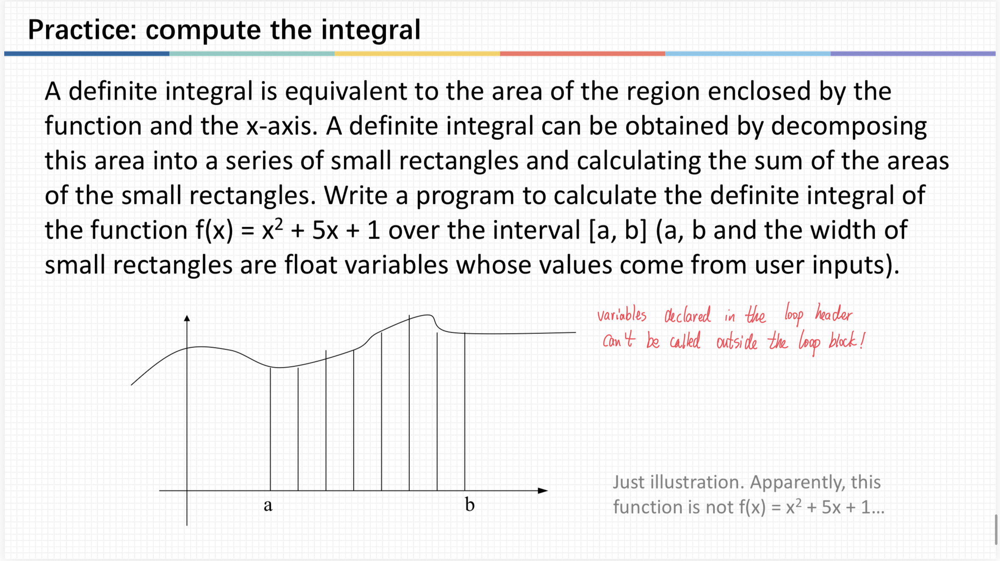
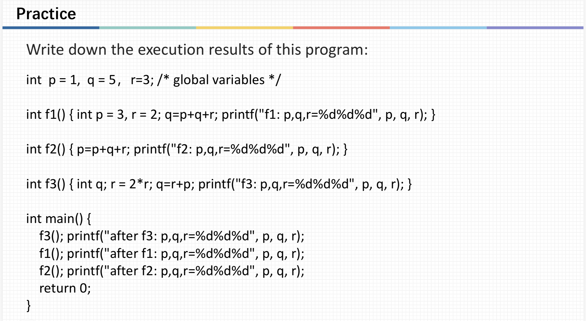

# ENGR1010: lecture11 - Branch, loops, MISTAKES.

## Key takeaways:
① Relation and logical operations;
② Branch: if and switch statements;
③ Loop: while and for statements;
④ break and continue.

## the switch statement
for the _switch-case_ function, I actually had many questions:
### 1. The Professor told us that without _break_ after each statement, the next case will be executed even if it does not match. But why?
   In fact, I now understand it as the next case is regarded as part of the current case, so the condition statement was directly skipped and not evaluated.
   
### 2. Why doesn't _case x>=90_ work?
  Because we can only put a value behind _case_, not a condition! This condition statement doesn't automatically evaluates itself to 1 or 0.

### 3. Do we need a _break_ for the _default_ branch?
  Nope we don't. As it is already the last case, there's no need to terminate the loop before reaching the end: we're already at the end. lol

## Some mistakes that I made.
So I was doing this practice question:

  

and wrote this program:

  

but there seemed to be something wrong with it. Can you find out all the problems?

Yep, first of all I've been using **int i** and **int x**, which doesn't **width**, which is a **double** data.

Secondly, I totally forgot about the initialization of _area_. So the function might just randomly assign it a starting value or something... I'm actually
not quite sure about this and GPT's being vague on this.

Thirdly, the loop condition is a bit incorrect, as I should've only put _i<b_ instead of _i<=b_ to avoid creating unwanted rectangles.

Finally, I could have used **%f** instead of **%lf** in the _printf_ statement, which is more conventional, but **%f** is completely valid too.

[← Back to home](/)
