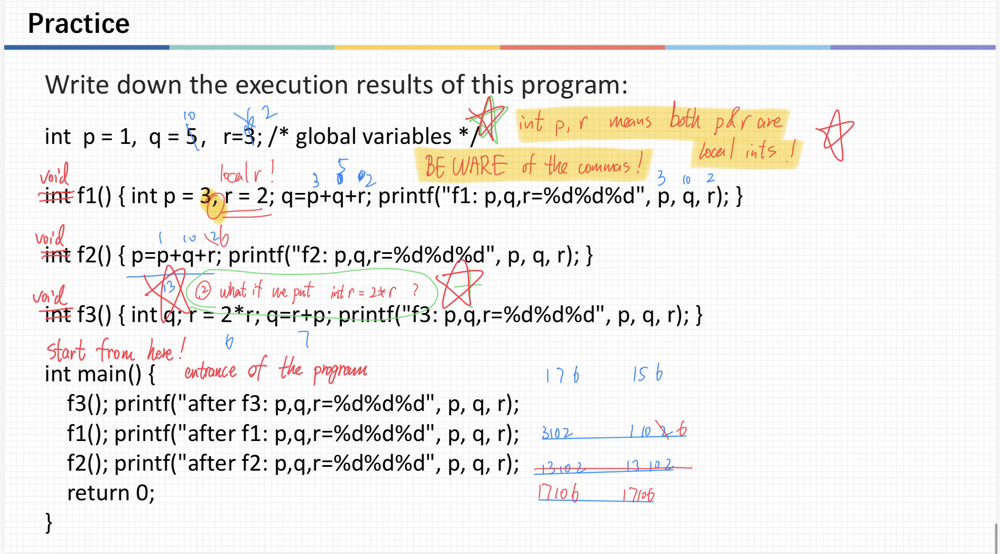
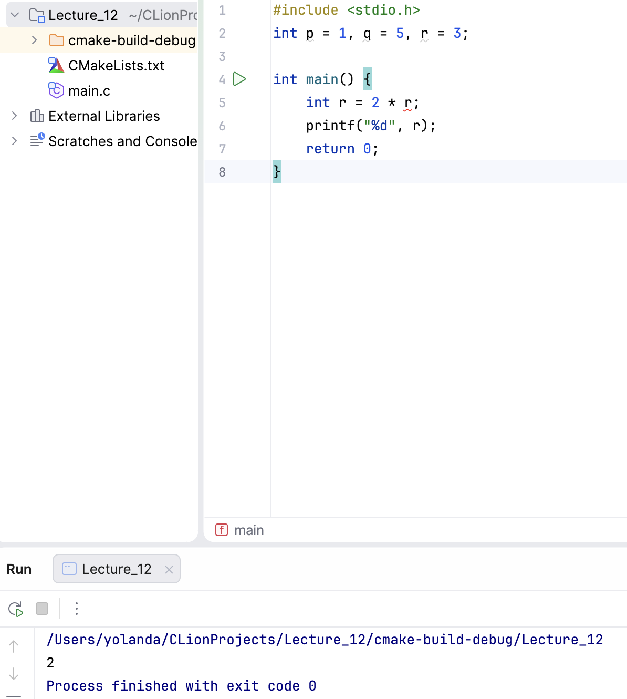
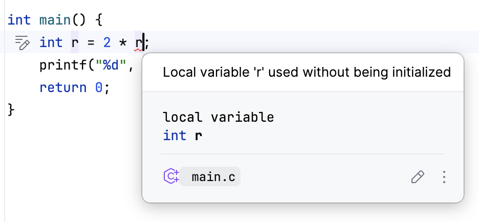

# ENGR1010: lecture 11 - Functions!

## Key takeaways from the lecture:
① Function Design;
② Function Call;
③ Parameter vs. Argument;
④ Scope of Variable.

## My experience with C functions before
The weekend before this lecture, when I was doing Lab3 for this course, I literally wrote 100+ lines of codes with loops nested within loops within loops 
just for one simple task of counting days. I was totally exhausted from trying to keep track of everything while reusing large blocks of codes. So I was 
like: maybe we can create a function in C for this? I didn't learn about functions yet, but asked GPT to give me a quick tutoring, and soon ended up with 
multiple functions nested within my main file and the codes were a lot easier to read.(but still 80+ lines long ToT)

However, I didn't really understand the "prototype" thing back then, so I basically put all the other functions before the main function (where they're 
called), to avoid any bugs.

After today's lecture, I think I actually understood what they are and how to use them, and will try to revise my lab a bit to put everything in the
conventional order. lol

## Header files.
I didn't fully understand what header files are for when we first briefly introduced them in lecture 9, but now I think I'm sort of getting it. It's like
inserting a file's worth of prototypes with one line. However, you have to keep the source files for your locally-defined functions where CLion can find 
when building the file.

## Void functions.
I was actually quite puzzled when I learned there's a void function giving no output in C, as the main function usually needs no outputs but instead always
includes this _return 0_, so I thought all functions in C have to have a output. However, we can in fact use a _void function()_ to eliminate the output.

Then why do we keep returning 0 with the main function?

Well, the Professor told me that when running the C file in the terminal, we can use different outputs (0, 1, 2 etc.) to determine the different types of
errors encountered by the code. So basically this is a convention to ease debugging. Quite cool, right?

## Global Variables V.S. Local Variables
I spent a bit of time distinguishing local variables from global variables. Like the program tracing we had in class is sooo hard for beginners. Wanna have a try?

  

And here's the answer:

  

It's so tricky that you've gotta be very careful about the **comma VS semicolon** part. **int p = 3, r = 2;** means creating two local variables p and r, whereas **int p = 3; r = 2;** only creates one local variable p and simply changes value of the global variable r.

Quite interesting huh? Better not do that in real programming tho, will probably get assassinated by co-developers LOL.

## Variable Shadowing
What's more, I was actually quite curious about what will happen if we first name a **global variable r** and then put **int r = r * 2** in a function, will it be using the value from the global variable or report an error?

  

What's soooo interesting is that the printed value here was nothing than I could've guessed. But the program did compile and ran tho. After consulting GPT, it turns out this is called variable shadowing, where the uninitialized local value is shadowing the initialized global value. But instead of reporting an error, C just decided to give me a random value 1 here. Weird huh?

  

[← Back to home](/)
