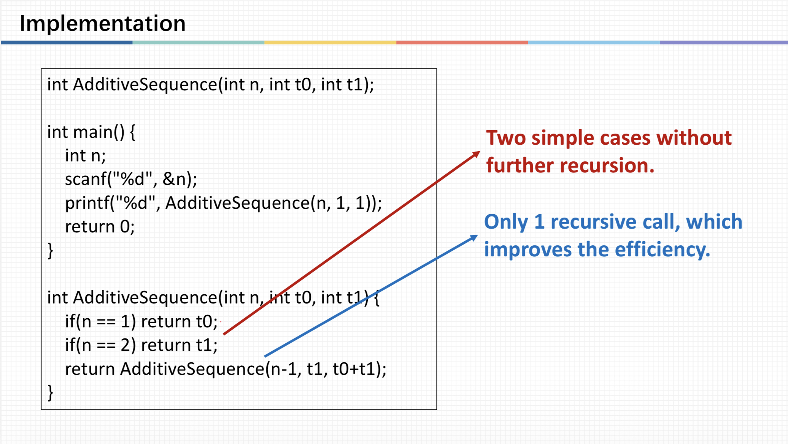

# ENGR1010: Lecture 13 - All about Algorithm.

## Key takeaways from the lecture:
Iterative Algorithms;
Time Complexity;
Recursive Algorithm;
Computational Efficiency.

## What is the difference between argument and parameter?
Well I really should've figured this out like long long ago, but sort of just used them interchangeably till now before the Prof actually 
explicitly said they are different. I was like WTF??? And after consulting the Prof I finally understood that an **argument** is something that we
put in the functions when we do the computations, so its value is already determined and known, whereas a **parameter** is the thing we put inside
the brackets while declaring a function, sort of like an empty box waiting for a value to be assigned.

## Recursion
Recursion struck me as a brilliant idea! Like I don't even have to know what's happening to each step, just let the computer automatically move 
from complexity to simplicity. That's smart!

  

This Fibonacci Sequence was bit hard to understand at first, as I thought **n** meant the nth fibonacci number. But instead we can understand it 
as having n steps from getting to our goal. For each step taken, t0 becomes t1 and t1 becomes t0+t1. No need for finding computed formulas, just
find one or two base cases, and let recursion do the rest!

[← Back to home](/)
