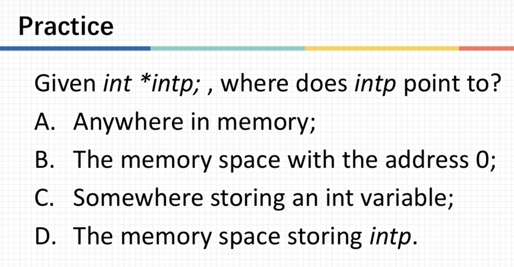
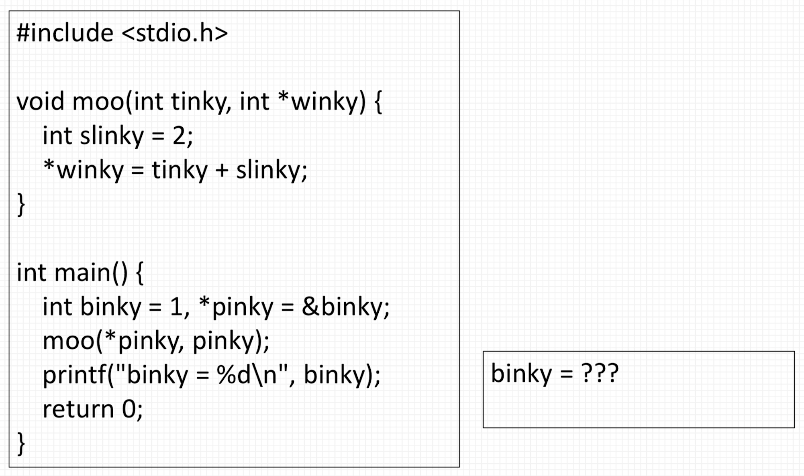
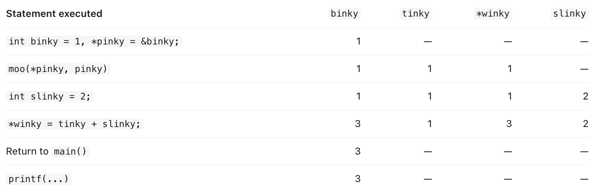
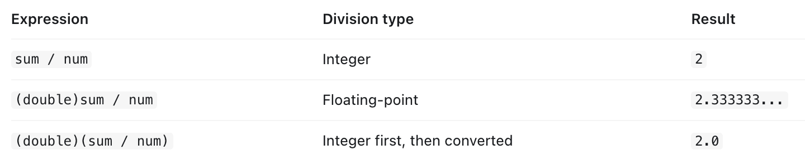

# ENGR1010: Lecture 14 - Finally...Pointers!

## Key takeaways:
Pointer basics;
File I/O with a FILE pointer;
Dynamic memory allocation.

## Practice 1: Uninitialized pointers

  

At first, I thought the answer is C, as __int *__ is a int pointer, and int pointers should point to an address storing int variables. However, it turned 
turned out that the answer is A! The pointer **intp** isn't initialized, so intp can point to anywhere in the memory.

## Call by Value V.S. Call by Address
**Call by Value**
Function call: swap(x, y);

void swap(int m, int n) {
    int temp;
    temp = m;
    m = n;
    n = temp;
}

**m** and **n** are both variables local to the function **swap**, so when the function call terminates, these variables are deleted, and the original 
global variables stay unchanged. After calling __swap__, nothing will be swapped.

**Call by Address**
Function call: swap(&x, &y);

void swap(int *m, int *n) {
    int temp;
    temp = *m;
    *m = *n;
    *n = temp;
}

__*(&x)__ = __x__

In the second function, we don't create copies of the values themselves, instead, we create copies of the address of the variables. Therefore, when we 
change the value stored in the address, the original values are also changed.

## Variables Local to Functions
When we close a function, that is to say, when the function returns a value and thus ends, the memory used to store all variables local to this function 
is released, so the original address of these local variables become invalid. The returning of their address is still grammatically correct, but the 
address itself is useless.

## Program Tracing Problems

  

Let's take a look at this practice:
**pinky** is a pointer storing the address of the global variable **binky**, so the line __moo(* pinky, pinky);__ means putting the argument 
**binky** and its address into the function __moo__. The line  __*winky = tinky + slinky;__ means the value referred to by **pinky**, which is **binky**, 
is assigned the value of **tinky**, which is also **binky**, plus **slinky**, the variable local to the function moo. As we are using the address to refer
to the global variable, the changes made in the function also affects the global variable.

  

Here's the program tracing table. Next time, when encountering this sort of problem in exams, we can try to draw these program tracing tables to get a 
clearer look of how the program works.

## The Star Operator
### Syntactic Marker
In function declaration, the star is used as a syntactic marker to declare the created variable is a pointer.
e.g. __int *intp1,*intp2__

### Dereference Operator
In assignment, the star is used as a dereference operator to get the value stored in the address to get the respective variable.
e.g. __*px = 3__

### "const char *filename;"
This pointer here means we access to the first element of this character string.

## fscanf
**fsanf** stops both at space and at different types. For example, __3.1416 PI__ stops at the space when we read "%s", but __3.1416PI__ stop at P when we 
read "%f", as the character P isn't readable as a float. However, __PI3.1416__ can be continued read as "%s" since float point numbers can also be read as 
string.

## Type Conversion
1. Explicit type casting — (type) expression
   (new_type) expression
   eg. int x = 7; (double) x = 7.0

  

 
   
2. Implicit type conversion - C does it automatically
   int x = 5;
   double y = 9;
   y/x = 1.8

3. Converting characters and integers
   int digit = ch - '0';
   
4. Converting strings to numbers
   atoi(), atof()

[← Back to home](/)
