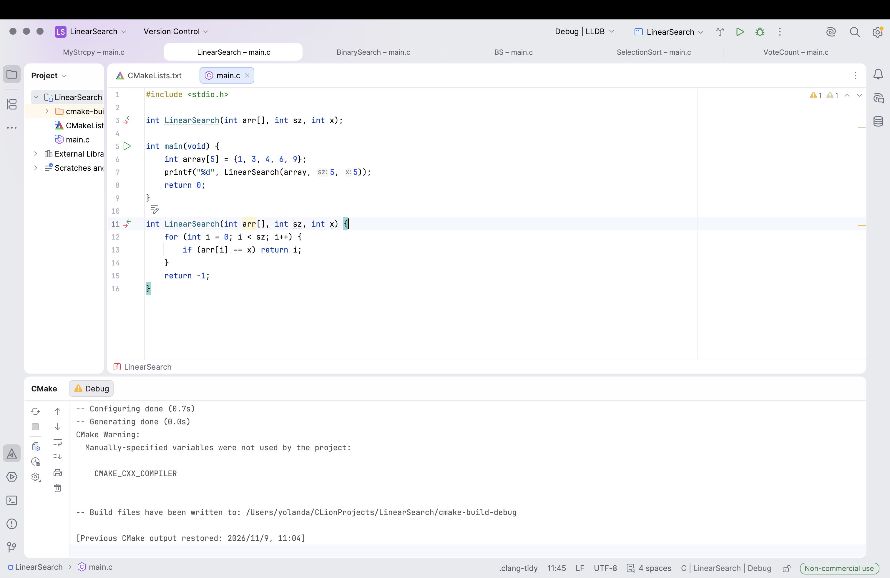
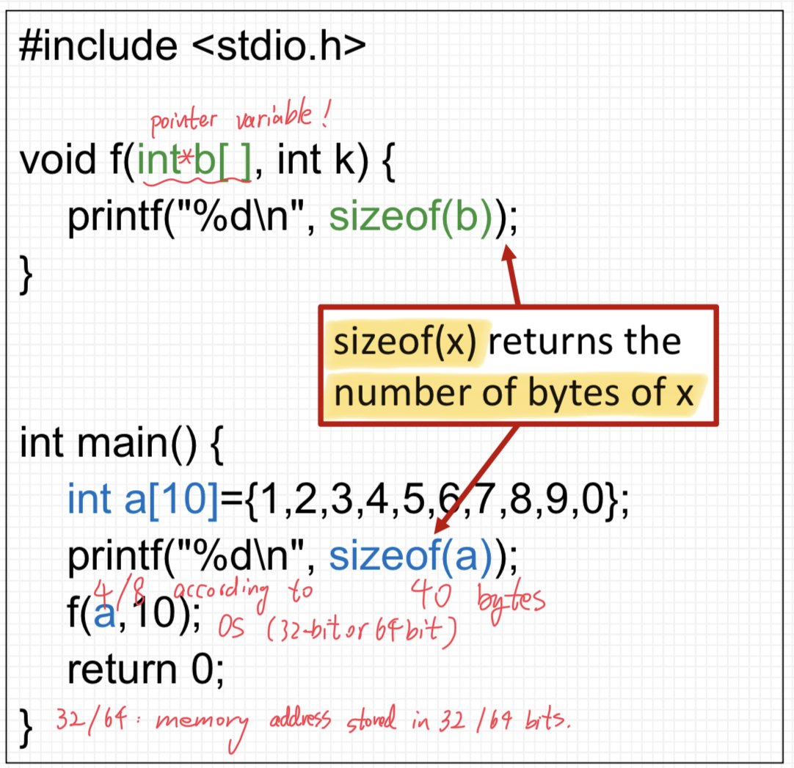
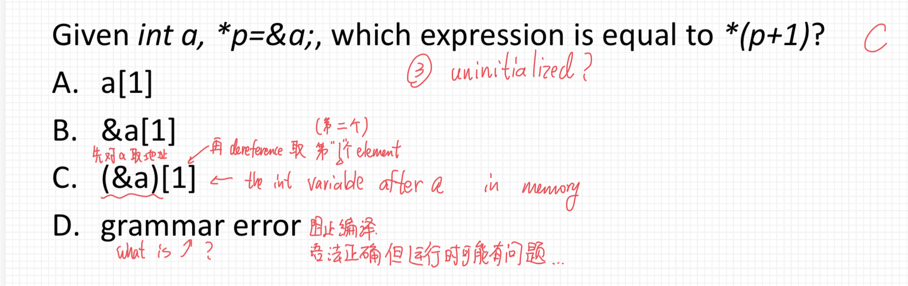
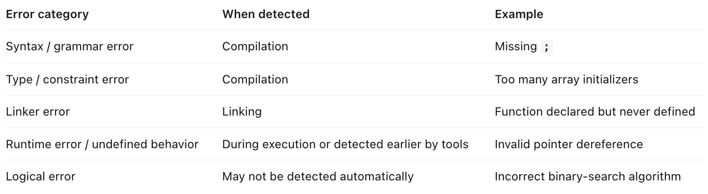
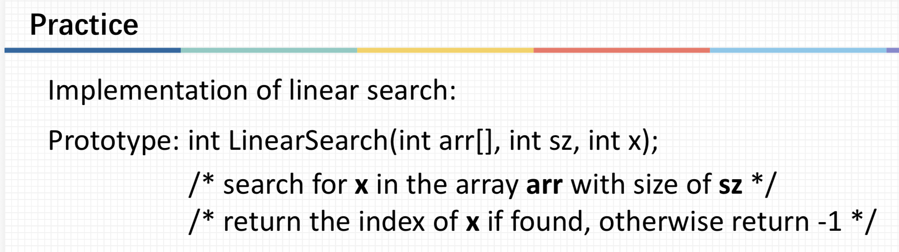

# ENGR1010: Lecture 15 - Arrays AND Pointers...

## Key takeaways:
Two-dimensional Array;
Relationship between Array and Pointer;
Searching Algorithm;
Sorting Algorithm.

## What if we store too many elements in a 2D array during initialization?
Well, it still can be compiled, but the initialization is invalid and will not give any valid results.

  

## Weird program tracing: why aren't these the same?

  

So we have this program where there's this int array, but directly applying **sizeof** returns the number of elements times the byte of 
each element of this type, whereas when we pass it into another function as an argument, using **sizeof** actually returns the number of bytes
occupied by a memory address! How is this even possible?

In fact, despite looking like a function, **sizeof** is actually an operator like **+** and **-**, so when we apply it directly to the array in the main
function, the array name is evaluated as the whole array. However, when the name is passed around, the array name becomes an array pointer, i.e. the address
of the zeroth element in the array. So it's size naturally becomes that of a memory address.

## What exactly is a grammar error?

  

So we had this multiple choice question, and I was actually stunned that this doesn't give a grammar error: the Prof said it doesn't do anything to the 
compilation process and is grammatically correct, but will induce undefined behavior, which isn't considered as grammar errors.

  

Anyways, here's my GPT generated table of all sorts of possible errors classified, so I won't be mixing different types of errors. Tho I do hope that we
won't be tested on these sort of details.

## Why we need the input size.

  

In fact, this actually sort of matches my earlier problem of **sizeof** of an array name. We need this explicit input of the size of the array here for
this function cuz if we do **sizeof(arr)/sizeof(int)** here, we'll only receive the ratio of the bytes a memory address takes and the bytes an integer
takes. Because **arr** here is passed into the function as a memory address.

[← Back to home](/)
