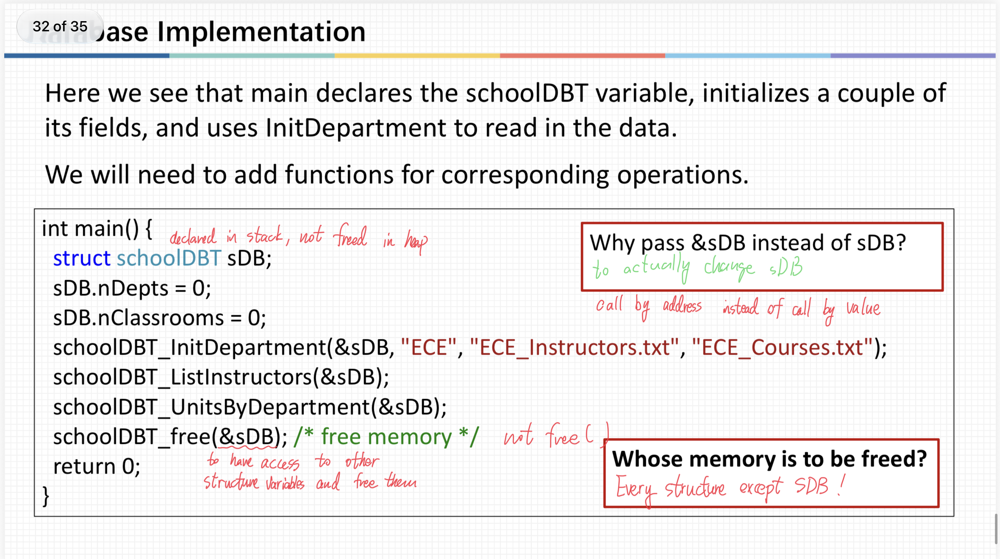

--
layout: default
title: "ENGR1010: Lecture 16 - STRUCTURE!"
--

# ENGR1010: Lecture 16 - STRUCTURE!

## Key takeaways:
Structure Basics;
Example: Database.

## Ways of defining new structure types:
1. **struct** TypeName{
     filed-declarations
   };
   **struct** TypeName VariableName (when declaring new variables of type **TypeName**)

2. **typedef struct** {
     filed-declaration
   } Typename;
   TypeName VariableName

## Element V.S. Pointer
When you try to access an element in a structure using call by value, you use the **dot operator**, putting __VariableName **.** MemberName__ to
access the member of a structure.

However, when you access an element in a structure using call by address (i.e. using a pointer), especially when you try to change a global variable in a 
local function, you use the **arrow operator**, and put __VariableName **->** MemberName__.

## Initialization V.S. Assignment
When you first declare and initialize a variable, you can directly use __VariableName = {value1, value2}__ to initialize the variable and give values to its
members all at once.

However, when you want to assign values to an already-declared structure variable, you must treat each and every member separately, i.e. use __VariableName.
Member1 = 1; VariableName.Member2 = 2;__

## An array of pointers
In a database, we might find it useful to store a list of pointers in an array so we can have access to the series of info they points to easily.
In this case, the type of the array is simply declared as __* whatever_type_the_elements_are__.

## Database Implementation

  

As we can see on this page, when freeing memory, we can only process manually allocated memory created with **malloc**, so the global variable sDB remains
unchanged.

And the input **&sDB** is for the function to have access to other memories allocated and organized around the memory address of sDB.

[← Back to home](/)
