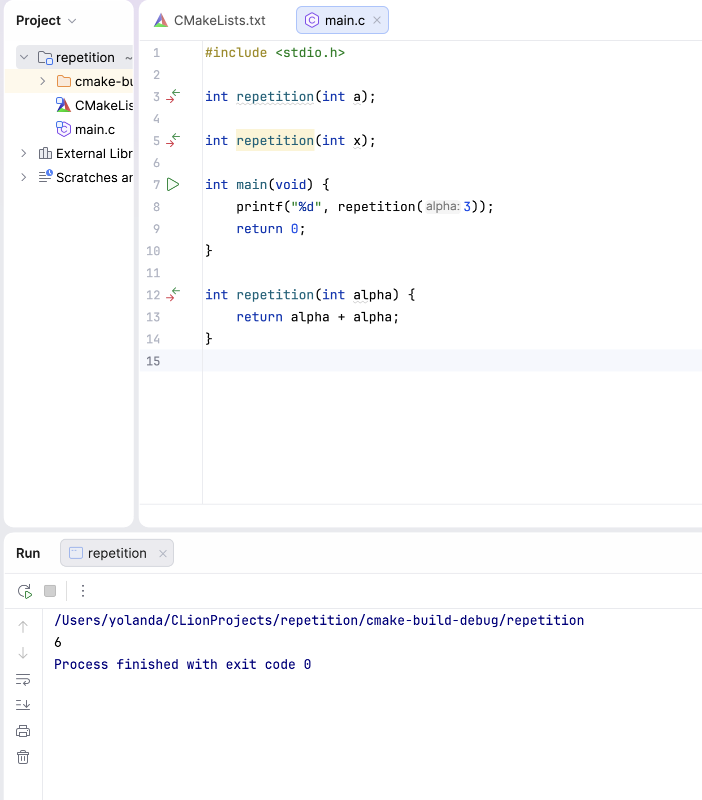

--
layout: default
title: "ENGR1010: Lecture 17 - C Library"
--

# ENGR1010: Lecture 17 - C Library

## Key Takeaways
Preprocessor Directives;
Library Interface;
Library Release;
Example: Random Numbers.

## Repeated Declaration V.S. Repeated Implementation
In C, redundant function prototypes are allowed as long as all declarations share the same input&output types. Even the parameters can be of different names.

However, we cannot do the implementation of a function twice, even if they are exactly the same.

  

## __MACROS__
In C, the macros with two underscores at each side are reserved for default system library. When declaring macros ourselves, we can avoid using these 
underscores around the variable name so as to not clash with existing macros. However, we can still use these underscores as long as the names are different.

We can access to macros defined in the header files directly by using their names in the program, for example RAND_MAX for the upper bound of generated
random numbers.

## Void V.S. NULL
So in some functions, we put **void** as the input/output argument to avoid inputting/returning any value. However, when the expected input is a pointer, 
such as in the case of the **time_t time(time_t * timer)** function, we cannot simply put void in the parenthesis if we have no special input. Instead, we 
put the **NULL** pointer, which means that we still have an input, only that the input is not providing any information and is not needed in the function.

## Rand()
To simulate a die with the function **rand()**, technically we cannot simply divide the possible range of generated numbers into six equal parts and assign
each part to the face of the die: cuz the number can't be divided by 6! So to fix this, we can just skip and regenerate when the output is 0, 1 or 2, so as 
to keep 6 a factor of the total number, and thus have an equal-faced die.

## Pseudo-random Seed
TBH I didn't truly understand why we have to change the seed every time before we start the program using the current time while we were studying MATLAB. 
But today, the Prof explained to us that if we don't, well, the result will be the same every time we open the program! Because the initial seed of all 
**rand()** function is the same, and the list of random numbers will be exactly the same too! Weird huh.

What's more, it's also very important to not reset the seed using current time in every loop iteration. That's because the loops are executed so quickly that
the time is probably unchanged between multiple loops. Therefore, if we use the same time again and again, the random number generated will stay the same too!
Next time, I'll definitely be extra careful where I put the seed initialization.

[← Back to home](/)
